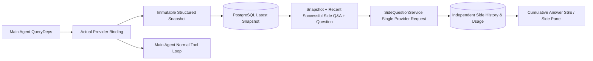

# VMT-23 `/btw`

Normal chat, the task MainAgent, and the current task's own Worker support independent side-question queries. Enter `/btw <question>` in the main input box to submit; an empty `/btw` or clicking the "Side Question" button opens history. Desktop uses an adjustable-width sidebar, while mobile uses a Drawer.

Side-question answers are generated from the Agent context snapshot taken at submission time, supporting streaming display, follow-ups, stopping, and clearing. Closing the panel, refreshing the page, or disconnecting SSE will not cancel model requests. Stopping only affects the current side-question; clearing cancels the active side-question and deletes side-question history while preserving the main context snapshot.

## Implementation Boundaries

Built upon Go, norma v0.3.7, Next.js, and existing Markdown / ResizablePanel / Drawer / AlertDialog components; norma source code was not modified, nor were new dependencies added for side questions. Planners, Workers inherited from other tasks, and tool-based subtask upgrades are out of scope.

- `capture.go` marks main loop requests only within `Options.Deps.CallModel / CallModelSync`. The Provider decorator sits inside the concrete model after outer routing pool selection, recording the actually selected model; compaction and summarization requests do not overwrite snapshots.
- Snapshots are published at request start, complete model responses, and terminal run states. Partial in-flight stream chunks are not published; tool calls maintain pairing via norma's `MessagesForAPI`, and tool execution results enter the snapshot on the next main model request or terminal run state. Stream aborts preserve the last valid boundary.
- Snapshots use deep JSON copies to preserve structured messages, system prompts, tool schemas, and generation parameters. Model inference does not hold snapshot locks or database transactions.
- `SideQuestionService` calls the concrete Provider; when necessary, it generates a side-question summary first. The final answer allows a single reduced retry only if the context window overflows on the first call before text or tool calls have been emitted. It does not create an agent session, connect to tool executors, the main transcript, activity feeds, or task graphs, nor does it pass through task model switching chains. Answer requests retain tool definitions for compatibility with existing structured tool contexts; summary requests omit tools. Newly returned tool calls have no execution path.
- One active request per parent session, up to four across a single service process, with a 120-second timeout per call. Side questions use an independent cancellation context bound to service lifetime.
- Side question requests retain model profile references and non-sensitive identity digests; credentials are retrieved from existing profiles at request time. If a profile is deleted, or identity fields like model, protocol, or endpoint address change, the main Agent must be run first to refresh the snapshot. Tests do not alter default product models.

## Persistence & Recovery

`db/schema.sql` automatically provisions `side_question_sessions` and `side_question_requests`. The former stores parent resources, latest snapshots, run IDs, versions, and clear versions; the latter stores questions, accumulated answers, statuses, models, snapshot timestamps, usage metrics, event ordinals, and pagination ordinals.

Parent session keys use the conversation ID, or task ID + exploration ID + intent ID. Workers do not use reusable execution slot naming.

Snapshots are written per parent session using coalesced writes flushed every 250 ms, with database comparison of `(run_id, version)` preventing stale overwrites. Selected snapshots are saved again immediately before side question submission. Memory allocations for large snapshots are released after successful saves; pending versions are retained on failure. Accumulated answer content is persisted at most once every 250 ms during streaming events, with terminal states saved immediately and retried on transient database errors.

Service startup marks lingering `running` requests as `interrupted`, preserving persisted partial answers and usage without automatic request replaying. The most recently saved context can be used directly for subsequent questions. Legacy sessions lacking snapshots require running the main Agent first, rather than reconstructing context from UI activity logs.

Clear operations increment the clear version and delete requests; conditional updates prevent delayed callbacks from writing stale data back. Deletion of physical parent resources cascades via foreign keys; Worker soft deletes remove side-question data in the same transaction and reject subsequent delayed snapshots. Task archiving prevents new requests, waits for main pipelines to halt, and cancels while waiting for side-question flushes; archive format is v3, remaining compatible with legacy v1/v2 archives that lack side-question tables.

History is fully preserved, returning up to 20 entries per page via an ordinal cursor. Model requests replay up to the 20 most recent successful Q&A pairs while enforcing token budgets; older Q&A entries maintain an independent rolling summary. When main context exceeds budget, only older parts of the side-question replica are summarized, preserving recent structured tool calls and results. Summarization, preparation progress, and usage count toward side-question concurrency, cancellation, and the 120-second timeout. See [Context Budget & Open Source Reference](CONTEXT_BUDGET.md).

## HTTP Contract

The following paths serve as `{parent}`, adhering to existing authentication and resource validation:

- `/api/conversations/{id}`
- `/api/tasks/{id}/chat`
- `/api/tasks/{id}/intents/{iid}`

| Request | Response & Behavior |
| --- | --- |
| `GET {parent}/side-questions?before={ordinal}` | `items` sorted descending, independent `current` run state, `snapshot` metadata, `next_cursor`; cursor 0 denotes latest page / end of pages |
| `POST {parent}/side-questions` | JSON `{ "question": "…", "client_request_id": "UUID" }`; new requests return 202 and request object; identical ID and question return existing object with 200 |
| `DELETE {parent}/side-questions` | Cancels and clears side-question Q&A for current parent session |
| `GET /api/side-questions/{requestID}/events` | `snapshot` SSE events, `id` as incremental ordinal, `data` as complete cumulative request object; sends `cleared` when purged |
| `POST /api/side-questions/{requestID}/cancel` | Explicit cancellation; terminal state readable from history or SSE |

Question length is capped at 4000 characters. Missing snapshots, modified model configurations, busy parent sessions, or idempotent ID collisions return 409; exceeding global concurrency limits returns 429. Every SSE connection transmits accumulated state upon connecting, without relying on previously received client text chunks. Frontend merges by request ID + ordinal, discarding obsolete callbacks when switching parent sessions or clearing history.

## Validation & References

Automated test suites, model verification, and known constraints are detailed in [VALIDATION.md](VALIDATION.md).

Independent request handling references [Grok CLI side-question.ts (pinned commit)](https://github.com/superagent-ai/grok-cli/blob/fb97af83f06dca873281d60168430f06c8de6324/src/utils/side-question.ts); execution isolation references [OpenCode (pinned commit)](https://github.com/anomalyco/opencode/tree/b3f1a96c6dd7adeb28b36dd11add1998fc84d67b). VMT-23 context utilizes norma structured messages, avoiding textual concatenation from frontend logs.
