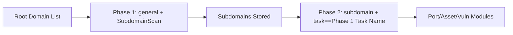

# ScopeSentry MCP User Guide

Designed for users with a **deployed ScopeSentry instance**. Connect to the platform via Cursor (or other MCP clients) without local source code.

## 1. Preparation

### 1.1 Verify Service Accessibility

- Default Web UI: `http://<host>`
- MCP Endpoint: `http://<host>/mcp` (If preceded by a reverse proxy or frontend proxy, use the actual `/mcp` address)

### 1.2 Create an API Key

1. Log in to the ScopeSentry Web UI in a browser
2. Navigate to the **API Key** management page to create a key (or create via admin API)
3. Save the returned `ssk_...` string (**displayed only once**)

### 1.3 Configure Cursor MCP

Cursor → Settings → MCP → Add Server:

```json
{
  "mcpServers": {
    "scopesentry": {
      "url": "http://<your-host>:8082/mcp",
      "headers": {
        "X-API-Key": "ssk_your_key"
      }
    }
  }
}
```

Or use: `Authorization: Bearer ssk_your_key`

After configuration, restart MCP or reload Cursor, and confirm that tools like `list_projects`, `list_assets`, etc., appear in the tool list.

---

## 2. Tool Overview

| Tool | Purpose |
| --- | --- |
| `list_projects` | Project tree grouped by tags (includes project ID) |
| `list_projects_data` | Paginated project list, searchable by name |
| `get_project` | Project details |
| `create_project` | Create a new project |
| `list_tasks` | Scan task list |
| `get_task` | Task details |
| `list_scan_templates` | Scan template list |
| `get_scan_template` | Template details |
| `list_plugin_modules` | Scan pipeline module names |
| `list_plugins` | Available plugins (including hash and default parameters) |
| `create_scan_template` | Create a scan template |
| `create_scan_task` | Create a scan task |
| `list_assets` | Query various assets (paginated list) |
| `count_assets` | Count asset totals (`/api/assets/common/total`) |
| `get_asset_detail` | Asset or vulnerability details |
| `add_asset_tag` | Add tags to assets |
| `list_nodes` | List of scan nodes |

Tool arguments are subject to each tool's schema description; search and filter syntax in `list_assets` and `count_assets` are identical. Read the `list_assets` description before querying assets.

When only the total count is needed, use `count_assets` (which maps to the Web pagination total endpoint), instead of repeatedly paginating through `list_assets`.

---

## 3. Common Workflows

### 3.1 Query Assets by Project

When the user or context **already specifies a project condition**, prioritize passing `filter.project` to narrow the scope and prevent slowdowns caused by cross-project queries. If no specific project is given, project filtering is not mandatory.

1. Call `list_projects` or `list_projects_data` to get the target project's **ObjectID** (`id` / `children[].value`).
2. Pass `filter.project` to `list_assets` (**must be the ObjectID, not the project display name**).

```json
{
  "asset_type": "asset",
  "pageIndex": 1,
  "pageSize": 20,
  "search": "domain=^example.com",
  "filter": {
    "project": ["<project_object_id>"]
  }
}
```

### 3.2 Create a Scan Task

1. Use `list_nodes` to get online node names.
2. Use `list_scan_templates` or `create_scan_template` to get template **ObjectID**.
3. Call `create_scan_task`: `name` and `node` are required; set `template` to the template ObjectID (not the template name).

**Target Source `targetSource` (matches Web UI):**

| targetSource | Description | Required Parameters |
| --- | --- | --- |
| `general` | Direct target input | `target` |
| `project` | Load targets from projects | `project` (array of project ObjectIDs) |
| `asset` | Search from Web asset database | `search`; optional `project`, `filter`, `targetNumber` |
| `RootDomain` | Search from root domain database | `search`; optional `project`, `filter`, `targetNumber` |
| `subdomain` | Search from subdomain database | `search`; optional `project`, `filter`, `targetNumber` |
| `UrlScan` | Search from URL scan results | `search`; optional `project`, `filter`, `targetNumber` |
| `*Source` (e.g. `subdomainSource`) | Create from asset page "select/search" | When `targetTp=search`, use `search`; when `targetTp=select`, use `targetIds` |

**Example — Direct root domain scan:**

```json
{
  "name": "example-subdomain-recon",
  "node": ["node-1"],
  "template": "<template_object_id>",
  "targetSource": "general",
  "target": "example.com\nfoo.com",
  "project": ["<project_object_id>"]
}
```

**Example — Continuous scan from subdomain database (filtered by previous task name):**

```json
{
  "name": "example-ports-and-vulns",
  "node": ["node-1"],
  "template": "<followup_module_template_object_id>",
  "targetSource": "subdomain",
  "search": "task==\"example-subdomain-recon\"",
  "project": ["<project_object_id>"]
}
```

### 3.3 Root Domain Full Reconnaissance (Two-Phase Recommended)

When the input is a **root domain** and **comprehensive reconnaissance** is required, it is strongly recommended to split the scan into two stages rather than running the entire pipeline at once.

**Reason:** Distributed tasks are dispatched per **individual target**. When a root domain is dispatched to a node, subdomains discovered on that node continue executing subsequent modules on the same node, which can cause load imbalances, slower throughput, and failure points.

**Best Practice:**

1. **Phase 1 — Subdomain Recon Only**
   - `targetSource`: `general`
   - `target`: All root domains (multiline)
   - Template: Enable only `SubdomainScan` and `SubdomainSecurity` (subdomain discovery + subdomain takeover)
   - Use `get_task` to wait for completion

2. **Phase 2 — Subsequent Modules**
   - `targetSource`: `subdomain`
   - `search`: `task=="<Phase 1 Task Name>"` (exact task name match)
   - Optional `project` to narrow scope
   - Template: Port scanning, asset fingerprinting, vulnerability scanning, etc. (SubdomainScan can be omitted)
   - Subdomains are dispatched as independent targets across all nodes with higher parallel throughput

You can also filter by task name in the Web UI "Subdomain" asset page and click "Create Task from Subdomain" for identical behavior.



### 3.4 Create a Scan Template

1. `list_plugin_modules` → List of module names
2. `list_plugins` (can filter by `module`) → Each plugin's `hash` and default `parameter`
3. `create_scan_template`: Use `modules` to specify "module → array of plugin hashes"

---

## 4. Asset Queries (`list_assets` / `count_assets`)

`count_assets` and `list_assets` share the same `asset_type`, `search`, and `filter` parameters. It returns `{ "total": N }`, corresponding to the Web API `/api/assets/common/total`.

```json
{
  "asset_type": "subdomain",
  "search": "task==\"some-task-name\"",
  "filter": {"project": ["<project_object_id>"]}
}
```

**Performance Tips (`list_assets` / `count_assets`):** When project context exists, prefer `filter.project` to narrow search scope; in `search`, use `==` exact match or `^` prefix match on indexed fields (see [4.3](#43-search-expression)) to avoid slow unindexed `=` regex scans across large tables. When no project context exists, filtering by project is not mandatory.

Supported types for `filter.project` are listed in table [4.4](#44-filter-exact-filtering).

### 4.1 Asset Types `asset_type`

`asset`, `RootDomain`, `subdomain`, `app`, `mp`, `UrlScan`, `SensitiveResult`, `DirScanResult`, `crawler`, `vulnerability`, `PageMonitoring`, `IPAsset`, `SubdomainTakerResult`

Alias examples: `web` → asset, `vuln` → vulnerability, `ip` → IPAsset, `url` → UrlScan

### 4.2 Parameter Reference

| Parameter | Description |
| --- | --- |
| `pageIndex` / `pageSize` | Pagination, defaults to 1 / 20 |
| `search` | Search expression DSL (see next section) |
| `filter` | Exact filter JSON object (see next section) |
| `sort` | Only UrlScan and DirScanResult support sorting by `length` |
| `sid` | Only SensitiveResult: sensitive rule name |

`search` and `filter` **can be used simultaneously**.

### 4.3 search Expression

Custom DSL (**not SQL**):

| Operator | Meaning | Indexed | Example |
| --- | --- | --- | --- |
| `=` | Fuzzy match (regex) | No index | `domain=example` |
| `==` | Exact match | **Uses index** | `port==443` |
| `!=` | Exclude | — | `port!="80"` |
| `&&` | AND | — | `domain==example.com && port==443` |
| `\|\|` | OR | — | `title=admin \|\| body=login` |

**Indexing and Operators:** Fields such as `domain`, `ip`, `port`, and `title` are indexed, but only **`==` exact match** or **values starting with `^` prefix match** (e.g. `domain=^example.com`) leverage the index; **`=` converts to regex fuzzy search and does not use index**, causing high latency on large datasets.

**Universal search fields across all types:** `tag`, `task` (task name), `rootDomain`

**Do not put project in search** (invalid or throws error when combined with `&&`). To filter by project, use `filter.project`.

**Common search fields per type:**

| asset_type | Fields |
| --- | --- |
| asset | domain, ip, port, service, app, title, statuscode, icon, banner, type, body, header |
| RootDomain | domain, icp, company |
| subdomain | domain, ip, type, value |
| app | name, icp, company, category, description, url, apk |
| mp | name, icp, company, category, description, url |
| UrlScan | url, input, source, resultId, type |
| SensitiveResult | url, sname, body, info, md5 |
| DirScanResult | url, statuscode, redirect, length |
| vulnerability | url, vulname, matched, request, response, level |
| crawler | url, method, body, resultId |
| PageMonitoring | url, hash, diff, response |
| IPAsset | ip, domain, port, service, webServer, app |
| SubdomainTakerResult | domain, value, type, response |

**search Examples:**

- `domain==www.example.com && port==443` (Exact match, indexed)
- `domain=^example.com` (Prefix match, indexed)
- `ip==192.168.1.1`
- `task=="some-task-name"`
- `level==high` (vulnerability)
- `statuscode==200` (DirScanResult)

Use `=` only when substring matching is truly needed, e.g. `title=admin` (unindexed; pair with project filters where possible).

### 4.4 filter Exact Filtering

JSON Object: Multiple values for the same key are evaluated as **OR**; different keys are evaluated as **AND**.

**Prioritize `project` when project conditions exist:** If the project is identified and the asset_type supports `project`, include it to reduce query overhead.

| filter key | Meaning | Value Specification |
| --- | --- | --- |
| `project` | Parent project | **ObjectID**, obtained via `list_projects` / `list_projects_data` |
| `task` | Source task | **Task name**, obtained via `list_tasks` `name` field |
| `port` | Port | e.g. `"443"` |
| `service` | Service / Protocol | e.g. `"https"` |
| `app` | Application fingerprint | e.g. `"Nginx"` |
| `icon` | Icon hash | |
| `statuscode` | HTTP status code | Primarily used for `asset` |
| `status` | Status | UrlScan/DirScan HTTP code; Vulnerability / Sensitive item status |
| `level` | Vulnerability severity | critical / high / medium / low / info |
| `type` | Record type | e.g. Subdomain DNS record type A, CNAME |
| `color` | Sensitive rule color | SensitiveResult |
| `sname` | Sensitive rule name | SensitiveResult |
| `tags` | Tags | |

**Available filter keys per asset_type:**

| asset_type | filter key |
| --- | --- |
| asset | project, port, service, app, icon, statuscode, type, task, tags |
| RootDomain | project, tags |
| subdomain | project, type, task, tags |
| app / mp | project, tags |
| UrlScan | status, tags |
| DirScanResult | status, tags |
| SensitiveResult | status, color, sname, tags |
| crawler | project, task, tags |
| vulnerability | project, level, status, task, tags |
| PageMonitoring / SubdomainTakerResult | tags |
| IPAsset | project, port, service, app |

**filter Example:**

```json
{"project": ["<project_object_id>"], "port": ["443"]}
```

**Combined Query Example:**

```json
{
  "asset_type": "asset",
  "search": "domain=^baidu && port==443",
  "filter": {"project": ["<project_object_id>"]},
  "pageIndex": 1,
  "pageSize": 10
}
```

**Notes:**

- Prioritize `filter.project` when project conditions exist (where supported); not mandatory if no project context.
- Never put project display names in `filter.project`.
- Use `==` for known values, `^` for prefixes; avoid fuzzy `=` on large tables.
- Use `filter.status` for UrlScan HTTP status; DirScanResult can use `statuscode==200` in `search`.
- For SensitiveResult rule filtering: use `sname=RuleName` in `search` or `filter.sname`.

### 4.5 Sorting `sort`

Supported only by **UrlScan** and **DirScanResult**:

```json
{"length": "ascending"}
```

Other types ignore `sort` and default to chronological ordering.

---

## 5. Scan Template Module Names

`TargetHandler`, `SubdomainScan`, `SubdomainSecurity`, `PortScanPreparation`, `PortScan`, `PortFingerprint`, `AssetMapping`, `AssetHandle`, `URLScan`, `WebCrawler`, `URLSecurity`, `DirScan`, `VulnerabilityScan`, `PassiveScan`

---

## 6. Troubleshooting

| Symptom | Resolution |
| --- | --- |
| MCP has no tools | Check URL, API Key, and verify ScopeSentry is running |
| 401 / 403 | Re-create or replace API Key |
| No assets returned | Verify `filter.project` is an ObjectID; do not put project in `search` |
| Template / Task creation fails | `template` must be template ObjectID; `node` must be an online node name |
| Query slow or hanging | Add `filter.project` if project is known; replace `=` with `==` or `^` on indexed fields; reduce `pageSize` |

---
